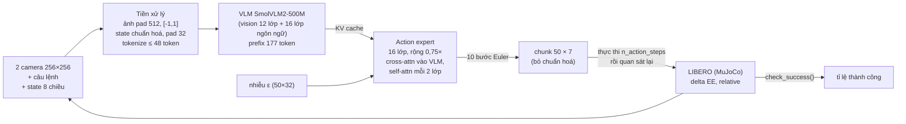

# FFI26 – Reproduce: SmolVLA trên LIBERO

Mọi số có ghi nguồn. Viết tắt: **probe** = `ffi26/ffi26/results/probe_report.json`; **diff** = `differences.md`;
**overview** = `docs/failure_overview.md`; `runs/` = `ffi26/ffi26/results/runs/`. Số của paper chưa đối chiếu được
với PDF trên máy nên ghi **[CHƯA KIỂM CHỨNG]**.

## 1. Model đã chọn

| Mục | Giá trị | Nguồn |
|---|---|---|
| Model | SmolVLA 0.45B (Shukor et al., arXiv 2506.01844) | |
| Checkpoint | `lerobot/smolvla_libero`, commit `a24f1f38`, khởi tạo từ `lerobot/smolvla_base` | `runs/*/…/checkpoint_revision.txt`; config.json |
| Code | LeRobot 0.6.2, commit `72e1d9e5` (code chính thức của tác giả), không sửa | `results/versions.txt` |
| Lý do chọn | checkpoint chính thức cho LIBERO trong LeRobot; 450M tham số nên chạy được trên 1 GPU 16 GB; action head dạng flow matching giống π0 | probe `2_parameters` |

## 2. Pipeline

### 2.1 Input và các thành phần

| Thành phần | Chi tiết | Tham số | Nguồn |
|---|---|---|---|
| Input | `camera1`, `camera2` (3×256×256), state 8 chiều, câu lệnh task | – | probe `1_…input_features` |
| Tiền xử lý | ảnh: resize+pad 512×512, đưa về [-1,1]; state, action: chuẩn hoá mean/std; ảnh không chuẩn hoá | – | probe `normalization_mapping`, `4_pipeline_trace` |
| Vision encoder (SigLIP của SmolVLM2) | 12 lớp; 64 token / ảnh, chiều 960 | 86,4M | probe `2_parameters`, `4_…tokens_per_image` |
| Mô hình ngôn ngữ | 16 lớp đầu của SmolVLM2-500M-Video-Instruct; prefix = 2×64 token ảnh + 48 token lời + 1 token state = 177 | 204,6M | probe |
| Action expert | 16 lớp, rộng 0,75× VLM; mỗi bước của chunk là 1 token (50 token); attend vào KV của VLM | 98,2M | probe |
| Projection nhỏ | state_proj, action_in/out_proj, action_time_mlp (nhúng τ bằng sin-cos) | 1,6M | probe |
| Tổng | 450,0M (392,9M trainable lúc train) | | probe |

### 2.2 Loss khi train (flow matching)

- Quy ước trong code: `x_τ = τ·ε + (1−τ)·A`, τ = 1 là nhiễu thuần. Mạng dự đoán vận tốc `v_θ(x_τ, o, τ)`.
- Loss: `L = ‖v_θ(x_τ, o, τ) − (ε − A)‖²`, trung bình trên 50 bước × 7 chiều, bỏ các bước đệm (`action_is_pad`).
- τ ~ Beta(1,5; 1)·0,999 + 0,001 (ưu tiên mức nhiễu cao).
- Probe (1 lần forward, không update, 3×8 mẫu của `lerobot/libero`): loss 0,036, so với 1,43 nếu dự đoán vận tốc 0.

Recipe công bố của checkpoint: train toàn bộ (không đóng băng), lr 1e-4, betas (0,9; 0,95), warmup 1.000, decay về 2,5e-6
sau 25.000 step (config.json). Batch 32, dataset `lerobot/libero`: [CHƯA KIỂM CHỨNG, chỉ có trong train_config.json] (diff §2).

### 2.3 Sinh action

1. Tính KV của prefix một lần (ảnh, lời, state).
2. Lấy nhiễu ε ~ N(0, I) cỡ 50×32, tích phân 10 bước Euler từ τ = 1 về 0: `x ← x − 0,1·v_θ(x, τ)`.
3. Cắt 7 chiều, bỏ chuẩn hoá → chunk 50 action (delta end-effector + gripper).
4. Thực thi `n_action_steps` (NAS) action đầu rồi quan sát lại.

Đo trên RTX 5070 Ti: 96,5 ms / chunk (batch 1) (probe `6_inference_trace`). Ngoài nhiễu ban đầu, quá trình sinh tất định.

### 2.4 Metric đánh giá

- Một episode **thành công** khi `check_success()` của LIBERO trả về đúng, tức mọi predicate goal trong file BDDL đều đúng,
  trước giới hạn bước (libero_10: 520, libero_spatial: 280). Hết giờ thì tính thất bại (`envs/libero.py:376-377`, diff §5).
- Báo **tỉ lệ thành công** theo task và tổng, kèm khoảng Wilson 95%. So hai cấu hình bằng **McNemar chính xác** trên các cặp
  cùng task, cùng init state.
- Episode i luôn dùng init state i, không phụ thuộc seed. Vì vậy seed chỉ đổi nhiễu lấy mẫu, không đổi cảnh (diff §3).

## 3. Setup

| Mục | Giá trị | Nguồn |
|---|---|---|
| Phần cứng | 1× RTX 5070 Ti 16 GB (sm_120), driver 580.178.04, CUDA 12.8 | `results/env_report.json` |
| Phần mềm | Python 3.12.16, torch 2.11.0+cu128, mujoco 3.8.1, robosuite 1.4.0, hf_libero 0.1.4, transformers 5.5.4; `MUJOCO_GL=egl` | `results/pip_freeze.txt` |
| Lệnh | `TAG=… NAS=… CM=relative N_EP=… SEEDS=… bash run_queue.sh` (gọi `lerobot-eval`) | `run_queue.sh`, `cmd.txt` mỗi job |
| Cờ bắt buộc | `--rename_map` (image→camera1, image2→camera2), `--env.control_mode=relative`, `--policy.n_action_steps` tường minh, `--eval.batch_size=5` | diff §3, §4 |
| Tái tạo môi trường | `setup_lerobot.sh`, `check_env.py`, `results/environment.yml` | |

## 4. Kết quả

| Run | Suite | NAS | Episode | Thành công | Nguồn |
|---|---|---|---|---|---|
| B_main | libero_10 | 1 | 3 seed × 10 init/task | **158/300 = 52,7%** (47,0–58,2) | diff §3a |
| D_nas1 | libero_10 | 1 | 1 seed × 50 init/task | 273/500 = 54,6% (50,2–58,9) | overview §1 |
| **D_nas10** | libero_10 | **10** | 3 seed × 50 init/task | **1092/1500 = 72,8%** (70,5–75,0); seed 1000: 368/500 = 73,6% | overview §1 |
| D_nas50 | libero_10 | 50 (mặc định của config) | 1 seed × 50 | 239/500 = 47,8% (43,5–52,2) | overview §1 |
| F_spatial | libero_spatial | 1 | 3 seed × 10 | **237/300 = 79,0%** (74,0–83,2) | diff §3a |
| F_spatial_nas10 / _nas50 / _abs | libero_spatial | 10 / 50 / 1 (absolute) | 1 seed × 10 | 82/100 / 58/100 / 2/100 | `docs/failures/spatial_results.md` |

So với paper (SmolVLA 0.45B, Table 2) [CHƯA KIỂM CHỨNG]: Long 71%, Spatial 90%.
- NAS=1 (cách hiểu "dự đoán lại sau mỗi action" trong paper) thấp hơn: Long −18,3 điểm, Spatial −11,0 điểm.
- NAS=10 đạt 72,8% trên Long, ngang số paper. Giá trị 10 lấy từ tài liệu LeRobot cho Pi0.5 (`lerobot/docs/source/libero.mdx:205`),
  không phải khuyến nghị cho SmolVLA. Từ 31/10/2026, phần Analyse/Improve dùng NAS=10.
- Độ lặp lại: hai lần chạy cùng cấu hình trùng 99/100 episode (diff §3c).

## 5. Khác biệt so với bản gốc

| Hạng mục | Bản gốc | Lần chạy này | Ảnh hưởng |
|---|---|---|---|
| Huấn luyện | paper: 100k step, batch 64, đa task 4 suite [CHƯA KIỂM CHỨNG] | không train; dùng checkpoint công bố (25k step theo config) | không kỳ vọng ra đúng số paper |
| Suite | 4 (Spatial, Object, Goal, Long) | 2: libero_10 (chính), libero_spatial (kiểm tra) | không có trung bình 4 suite |
| Episode | 10 / task | 30 (3 seed × 10) hoặc 50 / task; 3 seed dùng chung init state | CI gộp hẹp hơn thực tế khi seed trùng cảnh |
| n_action_steps | paper: ngầm hiểu 1 [CHƯA KIỂM CHỨNG]; config: 50 | đo cả 1, 10, 50 | NAS đổi kết quả tới 25 điểm (§4) |
| control_mode | delta EE [CHƯA KIỂM CHỨNG] | relative (absolute chỉ để thử: 2/100) | |
| Tên camera | dataset: `image`, `image2` | policy cần `camera1`, `camera2` → `--rename_map` | thiếu cờ thì báo lỗi feature mismatch |
| Đối chứng `smolvla_base` | – | không chạy được trên LIBERO (action 6 chiều, cần 7) | dùng số baseline trong paper |
| Checkpoint cũ `HuggingFaceVLA/smolvla_libero` | – | bỏ: là model khác (VLM, độ rộng expert, NAS khác) | số smoke/demo cũ không gộp |
| Phần cứng, phiên bản | không ghi trong file nào trên máy | §3 | |

Chi tiết từng dòng, nhật ký lỗi khi chạy và nguồn: `differences.md` §1–6.
