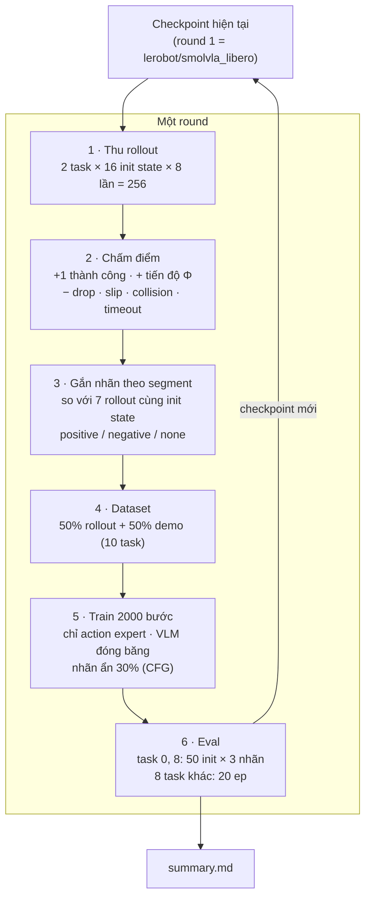
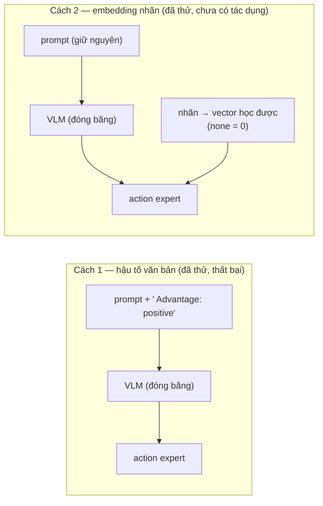

# Improve — RL cho SmolVLA (round 2)

Checkpoint xuất phát: `lerobot/smolvla_libero`, NAS = 10. Task train: **task 0** và **task 8** (libero_10).

## Luồng tổng thể

Khi test: chọn nhãn **positive** → mong đợi `positive > checkpoint chính thức` và `positive > negative`.

## Nhãn đưa vào model bằng cách nào

## Nhãn theo segment (ví dụ task 8)

Mỗi segment được so với các rollout khác trong nhóm tại cùng mốc → một rollout có thể *positive* ở segment 0 và *negative* ở segment 1.

## Tiến độ

| bước | trạng thái | kết quả |
|---|---|---|
| Kiểm tra detector (140 episode cũ) | ✅ | `detector_check/` |
| Chính thức trên 8 task khác | ✅ | 126/160 |
| Round 1 — hậu tố văn bản | ✅ thất bại | bảng dưới |
| Round 1 — embedding nhãn (cùng dữ liệu) | ✅ chưa có tác dụng | bảng dưới |
| Round 2, 3 | chờ | — |
| Ablation AWR (dữ liệu round 1) | ✅ không đổi | bảng dưới |
| AWR đầy đủ 6000 bước (≈1 epoch, dữ liệu round 1) | ✅ không đổi | bảng dưới |
| FPO 4 vòng (on-policy, PPO-clip, `fpo_plan.md`) | ✅ vòng 2–3 tốt hơn ở seed eval 1000 nhưng **không lặp lại ở seed 2000**; vòng 4 sụt | bảng dưới |

Round 1 (nguồn `summary.md`):

| | task 0 + 8 | held-out | 8 task khác |
|---|---|---|---|
| chính thức | 44/100 | 30/68 | 126/160 |
| **cách 1 — hậu tố văn bản** | | | |
| positive | 31/100 | 18/68 | 88/160 |
| không nhãn | 43/100 | 33/68 | 123/160 |
| negative | 37/100 | 26/68 | — |
| **cách 2 — embedding nhãn** | | | |
| positive | 38/100 | 23/68 | 118/160 |
| none | 44/100 | 31/68 | — |
| negative | 44/100 | 28/68 | — |
| **A2 — AWR** (trọng số theo advantage, không nhãn) | 43/100 | 32/68 | 128/160 |
| **A2 — AWR 6000 bước** (≈1 epoch) | | | |
| checkpoint 2000 | 47/100 | 32/68 | 121/160 |
| checkpoint 4000 | 41/100 | 27/68 | 123/160 |
| checkpoint 6000 | 41/100 | 29/68 | 126/160 |
| **FPO** (thu rollout mới mỗi vòng) | | | |
| sau vòng 1 | 49/100 | 31/68 | — |
| sau vòng 2 | **56/100** (McNemar p 0.01) | 37/68 | — |
| sau vòng 3 | **57/100** (McNemar p 0.01) | **39/68** | 122/160 |
| sau vòng 3, **seed eval 2000** (chính thức cùng seed: 45/100, 29/68) | 46/100 (cặp 18/17, p 1.00) | 31/68 | — |
| sau vòng 4 | 40/100 | 29/68 | 114/160 |

→ Cả hai cách: positive − negative = −6 điểm % (McNemar p 0.29) — không phát hiện được khác biệt; không nhãn ≈ chính thức (không quên). AWR ≈ chính thức (43 vs 44; 13 / 14 cặp, McNemar p 1.00). AWR 6000 bước: không checkpoint nào khác chính thức (McNemar p 0.68 / 0.70 / 0.68); loss train phẳng từ bước ~3000 (trung bình 1000 bước: 0.187 → 0.134 → 0.122 → 0.119 → 0.119 → 0.117, `round1/loss_awr6k.csv`).
Nhãn không bị đảo: frame positive chủ yếu từ rollout thành công (23 207 so với 9 638), negative gần như toàn từ rollout thất bại (43 369 so với 1 715) — `round1/segments.csv`.

## File

| | |
|---|---|
| `configs/` | config từng bước (thu, eval, report) |
| `summary.md` | bảng kết quả + kiểu thất bại |
| `round1/` | thống kê nhãn, loss CSV |
| `detector_check/` | kiểm tra detector |
| `~/ffi26/improve/src/reward_r2.py` | reward, detector, nhãn segment |
| `~/ffi26/improve/src/adv_embed.py` | embedding nhãn |
| `~/ffi26/improve/scripts/r2_*.py`, `train_r2.py` | thu · build · train · report |
| `~/ffi26/improve/improve_2026-10-31.md` | nhật ký chi tiết |

## FPO (chi tiết: `fpo_plan.md`, nhật ký `~/ffi26/improve/improve_2026-10-31.md`)

Tỉ lệ thành công khi thu rollout on-policy (256 rollout / vòng, 32 init train, seed khác nhau mỗi vòng; `improve/outputs/fpo/iter*/collect_info.json`):
96 → 124 → 131 → 133 / 256 (θ0 = chính thức … θ3).

Eval (task 0 + 8, cùng init/seed với chính thức): vòng 2 và 3 tốt hơn chính thức (56 và 57 / 100 so với 44; cặp 16/4 và 19/6, p 0.01);
held-out vòng 3: 39/68 so với 30/68. Vòng 4 sụt mạnh so với vòng 3 (cặp 1/18, p < 0.001) và 8 task khác 114/160 so với 126/160.
Lưu ý: chọn vòng tốt nhất trên cùng tập eval → lạc quan; 4 so sánh với chính thức (Bonferroni: 0.01 × 4 = 0.04).
Mỗi vòng chỉ cập nhật 100 / 69 / 50 / 43 bước rồi dừng sớm (clip_frac > 0.2).

**Xác nhận θ3 (21:22, `seed2000/summary.md`):** với seed eval mới 2000 (không dùng để chọn), θ3 46/100 so với chính thức 45/100
(cặp 18/17, p 1.00); held-out 31/68 so với 29/68. Gộp 2 seed: 103/200 so với 89/200 (cặp 37/23, p 0.09).
8 task khác (seed 1000): θ3 122/160 so với 126/160 (cặp 13/17). → **Không xác nhận được cải thiện**; kết quả seed 1000
có thể do chọn checkpoint trên cùng tập eval + nhiễu (cùng θ3, task 0 đạt 29/50 ở seed 1000 nhưng 19/50 ở seed 2000).
