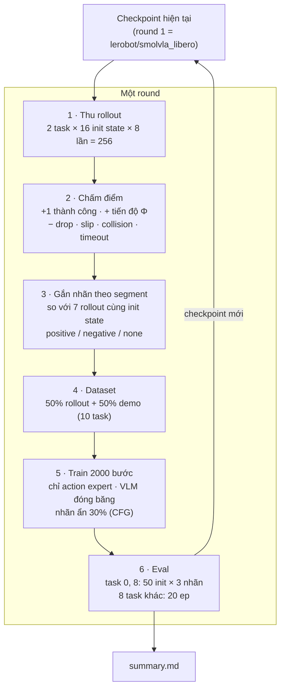
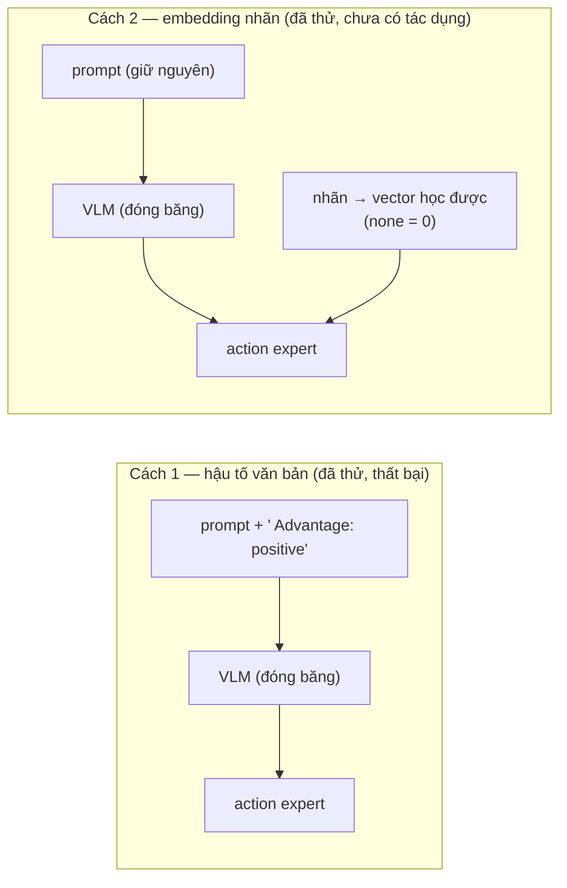
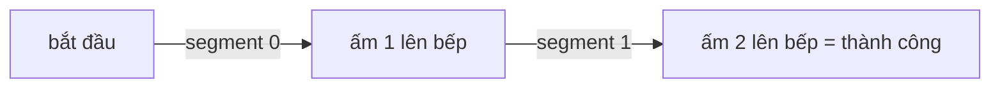

# Improve — RL cho SmolVLA (round 2)

Checkpoint xuất phát: `lerobot/smolvla_libero`, NAS = 10. Task train: **task 0** và **task 8** (libero_10).

## Luồng tổng thể

Khi test: chọn nhãn **positive** → mong đợi `positive > checkpoint chính thức` và `positive > negative`.

## Nhãn đưa vào model bằng cách nào

## Nhãn theo segment (ví dụ task 8)

Mỗi segment được so với các rollout khác trong nhóm tại cùng mốc → một rollout có thể *positive* ở segment 0 và *negative* ở segment 1.

## Tiến độ

| bước | trạng thái | kết quả |
|---|---|---|
| Kiểm tra detector (140 episode cũ) | ✅ | `detector_check/` |
| Chính thức trên 8 task khác | ✅ | 126/160 |
| Round 1 — hậu tố văn bản | ✅ thất bại | bảng dưới |
| Round 1 — embedding nhãn (cùng dữ liệu) | ✅ chưa có tác dụng | bảng dưới |
| Round 2, 3 | chờ | — |
| Ablation AWR | chờ | — |

Round 1 (nguồn `summary.md`):

| | task 0 + 8 | held-out | 8 task khác |
|---|---|---|---|
| chính thức | 44/100 | 30/68 | 126/160 |
| **cách 1 — hậu tố văn bản** | | | |
| positive | 31/100 | 18/68 | 88/160 |
| không nhãn | 43/100 | 33/68 | 123/160 |
| negative | 37/100 | 26/68 | — |
| **cách 2 — embedding nhãn** | | | |
| positive | 38/100 | 23/68 | 118/160 |
| none | 44/100 | 31/68 | — |
| negative | 44/100 | 28/68 | — |

→ Cả hai cách: positive − negative = −6 điểm % (McNemar p 0.29) — không phát hiện được khác biệt; không nhãn ≈ chính thức (không quên).
Nhãn không bị đảo: frame positive chủ yếu từ rollout thành công (23 207 so với 9 638), negative gần như toàn từ rollout thất bại (43 369 so với 1 715) — `round1/segments.csv`.

## File

| | |
|---|---|
| `configs/` | config từng bước (thu, eval, report) |
| `summary.md` | bảng kết quả + kiểu thất bại |
| `round1/` | thống kê nhãn, loss CSV |
| `detector_check/` | kiểm tra detector |
| `~/ffi26/improve/src/reward_r2.py` | reward, detector, nhãn segment |
| `~/ffi26/improve/src/adv_embed.py` | embedding nhãn |
| `~/ffi26/improve/scripts/r2_*.py`, `train_r2.py` | thu · build · train · report |
| `~/ffi26/improve/improve_2026-10-31.md` | nhật ký chi tiết |
