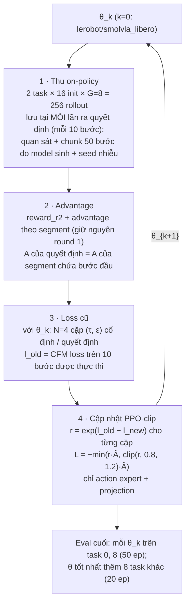

# Kế hoạch FPO (Flow Policy Optimization) cho SmolVLA — chờ duyệt

Trạng thái: **đã code + kiểm tra V1–V6 (đạt, xem §9); chờ OK để chạy đầy đủ**. Checkpoint xuất phát: `lerobot/smolvla_libero` (NAS = 10).
Lý do không xuất phát từ AWR: AWR 6000 bước không khác chính thức (47/41/41 vs 44 trên 100 ep, McNemar p ≥ 0.68, `summary.md`).

## 1. Luồng

## 2. Sự thật đã kiểm tra trong code (LeRobot 0.6.2)

| điểm | nguồn | hệ quả |
|---|---|---|
| `SmolVLAPolicy.forward(batch, noise, time, reduction="none")` nhận noise và τ từ ngoài, trả loss từng mẫu | `policies/smolvla/modeling_smolvla.py:293` | tính được l(θ; a, τ, ε) với (τ, ε) cố định → không cần sửa lerobot |
| noise shape (B, 50, 32); τ ~ Beta(1.5, 1), quy ước noise ở τ=1 | `modeling_smolvla.py:599-603, 742-774` | lưu seed, sinh lại (τ, ε) chính xác |
| `action_is_pad` che loss theo bước | `modeling_smolvla.py:319-351` | đặt pad cho bước 10–49 → loss chỉ trên 10 bước thật sự thực thi |
| chunk do `sample_actions` sinh ra ở không gian đã chuẩn hoá (ACTION = MEAN_STD), postprocessor mới bỏ chuẩn hoá | config checkpoint `normalization_mapping` | lưu chunk trực tiếp từ `_get_action_chunk` (trước `post`) = đúng không gian mà `forward` dùng |
| checkpoint không bật relative action; không có dropout trong expert | config checkpoint; grep `smolvlm_with_expert.py` | loss tất định khi cố định (τ, ε) — sẽ kiểm tra lại ở V2 |
| ảnh env 256×256 uint8, resize lên 512 trong `prepare_images` | config `resize_imgs_with_padding` | lưu ảnh mức env (256) và chạy lại `pre()` khi train |

## 3. Thành phần mới (không sửa round 1, không sửa lerobot)

| file | việc |
|---|---|
| `src/fpo_capture.py` | bọc `policy._get_action_chunk` trên instance: mỗi lần gọi tự sinh noise từ seed (lưu seed), lưu chunk (B, 50, 7) + bước hiện tại |
| `scripts/fpo_collect.py` | như `r2_collect.py` nhưng **không ghi video/dataset**; mỗi nhóm → `outputs/fpo/iter{k}/g{gid}.npz`: ảnh 2 camera (uint8), state, task, chunk, seed nhiễu, bước; cộng logs (sim state), rollouts.csv, segments.csv như round 1 |
| `scripts/fpo_train.py` | nạp quyết định → advantage → loss cũ (θ_k, cùng bf16) → PPO-clip → `save_pretrained` + copy processor từ θ_k; ghi CSV: step, loss, ratio mean/min/max, clip_frac, mean(l_old − l_new), grad_norm, lr, thời gian, VRAM |
| `scripts/fpo_loop.sh` | lặp K vòng: collect → train → (eval cuối) → `r2_report.py` |
| `configs/fpo.yaml` | mọi siêu tham số dưới đây |

Tái dùng nguyên: `rollout.py` (run_batch, load_policy NAS=10), `reward_r2.py` (reward, segment advantage), `phase3_eval.py`, `r2_report.py`.

## 4. Siêu tham số đề xuất

| tham số | giá trị | lý do |
|---|---|---|
| vòng lặp K | 4 | vừa thời gian (§7) |
| rollout / vòng | 256 (16 init × 8 / task, init train giống round 1; 34 init / task giữ làm held-out) | giống spec |
| seed thu | khác nhau mỗi vòng (`100000 + 10000·k + …`) | rollout mới thật sự |
| nhóm bị loại | spread < 0.1 (như round 1) → A ≈ 0, bỏ | |
| Â | A segment / std(A trong vòng), cắt [−5, 5]; không trừ trung bình (đã tương đối theo nhóm) | PPO chuẩn |
| N cặp (τ, ε) / quyết định | 4; mỗi bước train lấy ngẫu nhiên 1 cặp / quyết định | chi phí bằng train thường (batch 32 chuỗi) |
| ratio | theo từng cặp: r = exp(clamp(l_old − l_new, −5, 5)) | biến thể "per-sample ratio" |
| ε clip | 0.2 | PPO chuẩn |
| lr | 1e-5 hằng (warmup 20) | giống round 1 |
| epoch / vòng | 2 lượt qua dữ liệu, batch 32 (≈ 11k quyết định → ≈ 700 bước) | dừng sớm nếu clip_frac > 0.3 |
| đóng băng | vision + VLM; train action expert + projection (như round 1) | |
| demo BC | 0 (không trộn demo) | đo quên ở 8 task khác; nếu giảm > 10 điểm thì thêm BC demo hệ số 0.1 ở vòng sau |

**Rủi ro thang đo:** l là MSE trung bình trên 10×7 phần tử nên l_old − l_new có thể rất nhỏ → r ≈ 1, clip không bao giờ chạm. Ở V6 đo phân bố r sau 50 bước; nếu clip_frac < 1% sẽ báo lại và đề xuất hệ số nhân c trong r = exp(c·Δl) **trước khi** chạy đầy đủ.

## 5. Kiểm tra trước khi chạy thật (V1–V6, tổng < 20 phút GPU)

| # | kiểm tra | tiêu chí đạt |
|---|---|---|
| V1 | Tái hiện chunk: 1 nhóm (8 rollout). Từ quan sát đã lưu chạy lại `pre()` + `sample_actions` với cùng noise | chunk khớp chunk đã lưu (max |Δ| < 1e-3); `post(chunk[:10])` khớp hành động đã thực thi trong log (< 1e-4) |
| V2 | Loss tất định: tính l_old 2 lần cùng seed | giống hệt (|Δ| < 1e-6) |
| V3 | Ratio = 1 tại bước 0: trước cập nhật, l_new theo đường train (bf16, train mode) so với l_old | |l_old − l_new| trung bình < 1e-3 (nếu không đạt: tính l_old bằng đúng đường train) |
| V4 | Dấu gradient: 20 quyết định, Â = +1 cho nửa, −1 cho nửa, 20 bước lr 1e-4 | l giảm ở nhóm +, tăng ở nhóm − |
| V5 | Đóng băng: hash trọng số VLM/vision trước và sau V4 | không đổi; chỉ tham số expert/projection thay đổi |
| V6 | Lưu/nạp + smoke đầu-cuối: 2 nhóm → 50 bước train → lưu → `load_policy(NAS=10)` → so chunk với policy trong bộ nhớ (cùng noise) → eval 5 ep | chunk khớp; `n_action_steps = 10` khi chạy; ghi thời gian, VRAM, phân bố r, clip_frac |

Sau V1–V6: báo kết quả + ước lượng thời gian đã đo lại → **chờ OK** mới chạy đầy đủ.

## 6. Theo dõi trong lúc chạy

- Tỉ lệ thành công khi thu ở mỗi vòng (256 rollout on-policy, trên init train) → đường học miễn phí.
- CSV train: clip_frac, ratio, mean Δl, grad_norm, loss.
- Đánh giá cuối (giống mọi model trước, cùng seed eval → McNemar ghép cặp): θ_1…θ_4 trên task 0, 8 × 50 init (tất cả + held-out 34/task); θ tốt nhất (theo task 0+8) thêm 8 task khác × 20 ep.
- Lưu ý chọn θ tốt nhất trên cùng tập eval → kết quả tốt nhất bị lệch lạc quan; báo cả θ_4 (không chọn).

## 7. Thời gian & VRAM (ước lượng từ số đo round 1)

| bước | ước lượng | căn cứ |
|---|---|---|
| code + V1–V6 | ≈ 1.5 h code, ≈ 15 phút GPU | |
| thu / vòng | ≈ 20 phút | round 1: phần rollout 1110 s; không ghi video (round 1 ghi mất 1338 s) |
| loss cũ / vòng | ≈ 3 phút | ≈ 11k quyết định × 4 cặp, chỉ forward |
| train / vòng | ≈ 6 phút | ≈ 700 bước × ≈ 0.46 s/bước (round 1: 917 s / 2000 bước) |
| 4 vòng | ≈ 2 h | |
| eval cuối | ≈ 4 × 9 phút + 12 phút ≈ 50 phút | round 1: ≈ 5 s/ep |
| VRAM | train ≈ 7–8 GB (torch), đỉnh toàn GPU ≈ 11.5 GB lúc thu | round 1: 7.13 GB / 11.5 GB |
| đĩa / RAM | ≈ 4.5 GB / vòng (ảnh uint8), nạp RAM khi train | còn 152 GB đĩa, 37 GB RAM |

Bắt đầu chạy đầy đủ dự kiến ≈ 20:00, xong ≈ 23:00 — trước hạn 03/11 08:00.

## 8. Khác biệt so với FPO gốc (ghi rõ để không mơ hồ)

- Chỉ train action expert (VLM đóng băng); FPO gốc train toàn bộ.
- Advantage theo segment, tương đối theo nhóm, không critic (GRPO-style) thay cho GAE.
- Loss CFM chỉ trên 10 bước được thực thi của chunk 50 bước.
- Ratio theo từng cặp (τ, ε), không lấy trung bình N cặp trước khi exp.

## 9. Kết quả kiểm tra (31/10, dữ liệu smoke: 2 nhóm task 0, 16 rollout, 637 quyết định, `outputs/fpo/smoke/verify.json`)

| # | kết quả | đạt |
|---|---|---|
| V1 | hành động thực thi tái tạo chính xác từ chunk đã lưu (sai số 0); chạy lại chunk: sai số TB 0.0035 (max 0.073) — nhiễu bf16 khi đổi thành phần batch; với nhiễu sai: 0.044 (12×) | ✅ |
| V2 | l_old tính 2 lần: khác 0 | ✅ |
| V3 | cùng batch 32 (xáo trộn): |Δl| TB 3e-10; batch 8: 8.7e-4 (l TB 0.035) → ratio = 1 tại bước 0 | ✅ |
| V4 | (lr 1e-5, c = 1/mean l_old, 30 bước) l nhóm A+ 0.036 → 0.023, nhóm A− tăng +2.7 | ✅ dấu đúng |
| V5 | 345 tensor đóng băng không đổi; 155/155 tensor train thay đổi | ✅ |
| V6 | lưu/nạp: chunk khớp tuyệt đối, NAS = 10; train 38 bước: 0.45 s/bước, VRAM torch 8.3 GB; eval 5 ep task 0: 2/5, trùng từng episode với chính thức | ✅ |

### Phát hiện và thay đổi so với §4

1. **Trọng số bf16 (ảnh hưởng cả round 1).** 129/155 tensor train (action expert, 96.6M tham số) lưu ở bf16; bước AdamW ~1e-5 nhỏ hơn độ phân giải bf16 → bị làm tròn mất. Đo trên checkpoint round 1 so với chính thức: AWR 6000 bước chỉ 5.5% phần tử expert bf16 từng thay đổi (A1: 5.4%), phần fp32 (3.2M) thay đổi 97–100%. → Rất có thể là lý do mọi biến thể round 1 ≈ chính thức. FPO: ép tensor train sang fp32 khi train (checkpoint nạp lại về bf16 như chính thức).
2. **Thang ratio.** Với c = 1, ratio của hành động tốt tối đa exp(l_old) ≈ 1.036 → không bao giờ bị clip. Dùng c = 1/mean(l_old) (≈ 23): clip 0.2 ≈ loss đổi ~20%.
3. **lr.** Sau khi sửa (1), lr 1e-5 làm policy trôi nhanh (38 bước: clip_frac 0.72, ratio min 0.007, loss trên hành động của chính nó 0.044 → 0.11). Quét: 3e-6 → clip_frac 0.23, 1e-6 → 0.01. Chọn **lr 1e-6 + dừng sớm khi clip_frac (10 bước gần nhất) > 0.2**.
4. **N cặp = 2** (pass loss cũ: 26 s / 637 quyết định × 4 cặp).
5. Eval 8 task khác chỉ cho θ_4 (cố định trước, không chọn trên tập eval).

### Ước lượng đã đo lại

| bước | thời gian |
|---|---|
| thu / vòng | ≈ 17 phút (smoke: ≈ 30 s / nhóm × 32 nhóm) |
| loss cũ / vòng | ≈ 4 phút (≈ 11k quyết định × 2 cặp) |
| train / vòng | ≤ 5 phút (≤ 700 bước × 0.45 s, thường dừng sớm) |
| 4 vòng | ≈ 1 h 45 |
| eval (4 × 100 ep + θ_4 × 160 ep) + report | ≈ 50 phút |
| **tổng** | **≈ 2 h 35**; VRAM torch ≤ 9 GB khi train, đỉnh toàn GPU ≈ 11.5 GB khi thu |

Chạy: `bash ~/ffi26/improve/scripts/fpo_loop.sh` (tmux), log `outputs/fpo/loop.log`.
