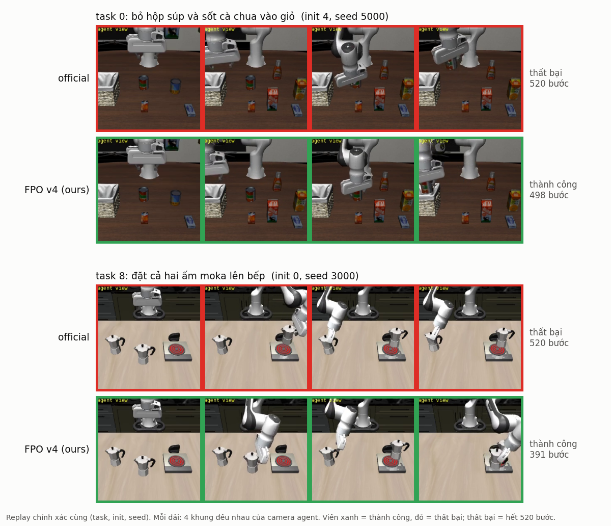

# FFI26: SmolVLA trên LIBERO — Reproduce, Analyse, Study, Improve

Checkpoint `lerobot/smolvla_libero` trên LeRobot, 1 GPU 16 GB. Cấu hình chính: libero_10, `n_action_steps = 10`.



*Official và FPO v4 (ours) trên cùng episode, camera agent. Hai episode v4 thành công còn official thất bại, chọn để minh hoạ (v4 cũng có episode thua official); thống kê trên toàn bộ 300 episode nằm ở mục Kết quả. Video: `ffi26/ffi26/results/videos/3_v4_paired/`. Hình: `docs/images/make_readme_fig.py`.*

## Kết quả

### Reproduce

| Suite | `n_action_steps` | Episode | Thành công |
|---|---|---|---|
| libero_10 | 10 | 3 seed × 10 task × 50 init | **72,8%** (paper: 71%, chưa kiểm chứng) |
| libero_10 | 1 | 3 seed × 10 task × 10 init | 52,7% |
| libero_spatial | 1 | 3 seed × 10 task × 10 init | 79,0% |

Nguồn: `docs/reproduce.md`.

### Improve: RL trên task 0 và task 8 của libero_10

Cách so sánh:

- Mọi phương pháp chạy trên cùng init state và seed, nên so sánh được theo từng cặp episode.
- Task đã train (task 0, task 8): mỗi task 50 init × 3 seed (3000 / 4000 / 5000), tổng 300 episode.
- Quên (8 task còn lại): mỗi task 20 init, seed 1000, tổng 160 episode.

| Phương pháp | Thay đổi so với bản trước | Task 0 | Task 8 | Task 0 + 8 | 8 task còn lại |
|---|---|---|---|---|---|
| official | checkpoint gốc | 40,7% | 40,0% | 40,3% | 79,4% |
| FPO v1 | PPO-clip với tỉ số tính từ loss flow matching, on-policy, 4 vòng | 41,3% | 24,0% | 32,7% | 69,4% |
| FPO v2 | expert fp32, batch 128, thêm loss BC trên rollout thành công | 33,3% | 50,7% | 42,0% | 67,5% |
| FPO v3 | + demo replay chống quên, chuẩn hoá advantage theo task | 30,7% | 58,7% | 44,7% | 71,9% |
| **FPO v4** | + trọng số advantage theo segment, không trừ mean | 40,0% | 53,3% | **46,7%** | **78,1%** |

- **v4 là phương pháp duy nhất hơn official có ý nghĩa thống kê** (McNemar theo cặp, p = 0,025). Phần tăng đến từ task 8 (p = 0,002); task 0 ngang official.
- v4 gần như không quên: 78,1% so với 79,4% (p = 0,83). v1, v2, v3 đều kém official rõ ở 8 task còn lại (p = 0,014 / 0,003 / 0,017).
- v4 hơn v3 về tổng nhưng chưa có ý nghĩa (p = 0,55). v4 kéo task 0 về lại mức official (v3: 30,7%).
- v1 đạt 57% ở vòng sàng lọc (bảng dưới) nhưng không lặp lại ở seed 2000. Trong bảng trên, v1 còn kém official (p = 0,03).

Nguồn: `ffi26/ffi26/results/round2/fpo_v4/pooled.md` (official, v2, v3, v4), `fpo_v2/seed*/episodes.csv` (v1).

#### Vòng sàng lọc: A1, A2 (offline), FPO v1

Trước FPO đã thử hai cách offline. Cả hai đều dùng rollout của checkpoint gốc, chấm reward theo tiến độ và tính advantage theo nhóm rollout cùng init state.

- **A1** (kiểu RECAP): gắn nhãn advantage positive / negative cho từng segment, rồi fine-tune có điều kiện theo nhãn. Khi chạy thì chọn nhãn positive. Có 2 cách đưa nhãn vào: hậu tố trong prompt, hoặc embedding học được đưa vào action expert.
- **A2** (AWR): fine-tune flow matching có trọng số theo advantage, không dùng nhãn.

Giao thức khác bảng trên nên không so trực tiếp: seed 1000, 50 init mỗi task, expert bf16; 8 task còn lại × 20 init.

| Phương pháp | Task 0 + 8 | 8 task còn lại |
|---|---|---|
| official | 44/100 | 126/160 |
| A1, hậu tố prompt, nhãn positive | 31/100 | 88/160 |
| A1, embedding, nhãn positive | 38/100 | 118/160 |
| A2 AWR, 2000 bước | 43/100 | 128/160 |
| A2 AWR, 6000 bước (tốt nhất: bước 2000) | 47/100 | 121/160 |
| FPO v1 θ3 | 57/100 | 122/160 |
| FPO v1 θ3, seed 2000 (official: 45/100) | 46/100 | — |

- A1: nhãn không có tác dụng. Chọn nhãn positive còn kém nhãn negative 6 điểm % (p = 0,29); hậu tố prompt còn làm hỏng các task khác.
- A2: ngang official ở mọi checkpoint (p ≥ 0,68).
- Từ đây chuyển sang RL on-policy (FPO), vì hai cách offline trên không cải thiện được so với checkpoint gốc.

Nguồn: `ffi26/ffi26/results/round2/summary.md`, `readme_ROUND2.md`.

**DSRL (chưa chạy, chỉ là kỳ vọng).** DSRL giữ nguyên SmolVLA và học một policy nhỏ chọn nhiễu ban đầu ε của flow matching.

- Kỳ vọng: vì không sửa trọng số SmolVLA nên không quên các task khác, và không cần gradient qua VLA.
- Hạn chế dự kiến: chỉ chọn được trong những hành vi mà SmolVLA đã tạo ra được từ nhiễu.
- Repo này chưa có số liệu nào cho DSRL.

Chi tiết: `docs/analyse.md`, `docs/study.md`, `ffi26/ffi26/results/round2/readme_ROUND2.md`.

## Cấu trúc

```
docs/                     Reproduce / Analyse / Study, phân tích thất bại
differences.md            khác biệt so với paper, nhật ký lỗi
setup_lerobot.sh, check_env.py, smoke_test.sh     cài đặt
run_queue.sh, collect_results.py                  eval Reproduce
ffi26/ffi26/
  improve/                code Improve (src/, scripts/), output eval
  results/runs/           kết quả Reproduce
  results/round2/         config + bảng kết quả Improve
  results/videos/         video so sánh các phương pháp
  demo/                   chạy demo một checkpoint
```

## Cài đặt

Các script dùng đường dẫn `~/ffi26`, nên cần tạo symlink trước:

```bash
git clone <repo> && cd <repo>
ln -s "$PWD/ffi26/ffi26" ~/ffi26
LEROBOT_REF=72e1d9e5e76ee719bacfc78bc34d817bee5fb521 bash setup_lerobot.sh   # env conda `lerobot`, LeRobot, LIBERO
conda activate lerobot && python check_env.py && bash smoke_test.sh
export MUJOCO_GL=egl PYOPENGL_PLATFORM=egl
```

Các script `improve/scripts/*.sh` gọi `source /opt/miniconda3/etc/profile.d/conda.sh`. Nếu conda cài ở chỗ khác thì sửa dòng này.

## Chạy lại Reproduce

```bash
TAG=D_nas10 NAS=10 CM=relative N_EP=50 SEEDS="1000 1001 1002" bash run_queue.sh
python collect_results.py --tag D_nas10
```

Kết quả nằm ở `~/ffi26/results/runs/D_nas10/`.

## Chạy lại Improve (FPO v3, v4)

```bash
cd ~/ffi26/improve && R=~/ffi26/results/round2/configs
# 1. dữ liệu demo (một lần)
python scripts/download_demos.py
python scripts/phase2_demos_subset.py --config $R/round1.yaml
python scripts/fpo_build_demo_cache.py --config $R/fpo_v3.yaml
# 2. v2 (v3 và v4 dùng lại rollout vòng 0 và eval official của v2)
bash scripts/fpo_v2_loop.sh
# 3. v3, v4 (mỗi cái khoảng 3 giờ)
bash scripts/fpo_v3_loop.sh
bash scripts/fpo_v4_loop.sh
```

Mỗi loop: train 4 vòng → chọn checkpoint → eval → bảng `results/round2/fpo_v{3,4}/pooled.md`.
Checkpoint lưu ở `improve/outputs/fpo_v{3,4}/iter3/train/pretrained_model` (không có trong repo).
Khi chạy lại, script bỏ qua các bước đã xong.

Demo nhanh một checkpoint: `ffi26/ffi26/demo/readme_DEMO.md`.
